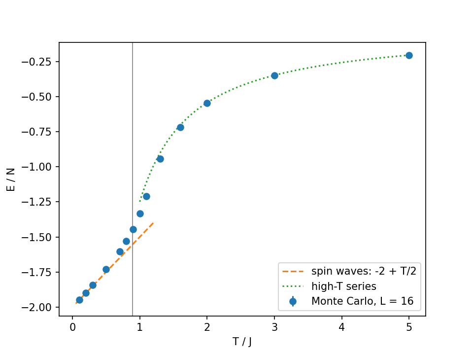
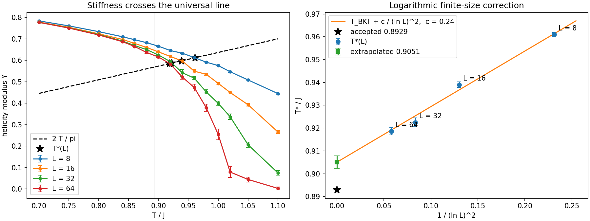
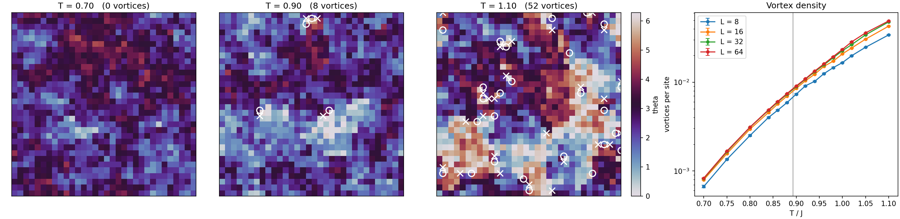
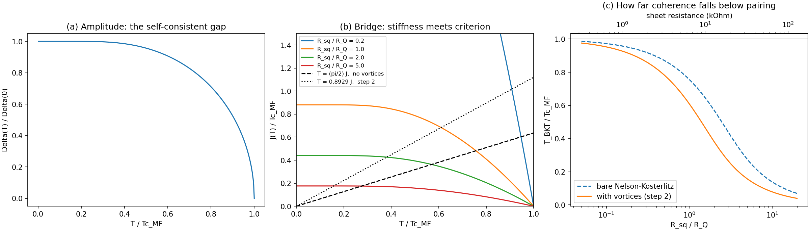
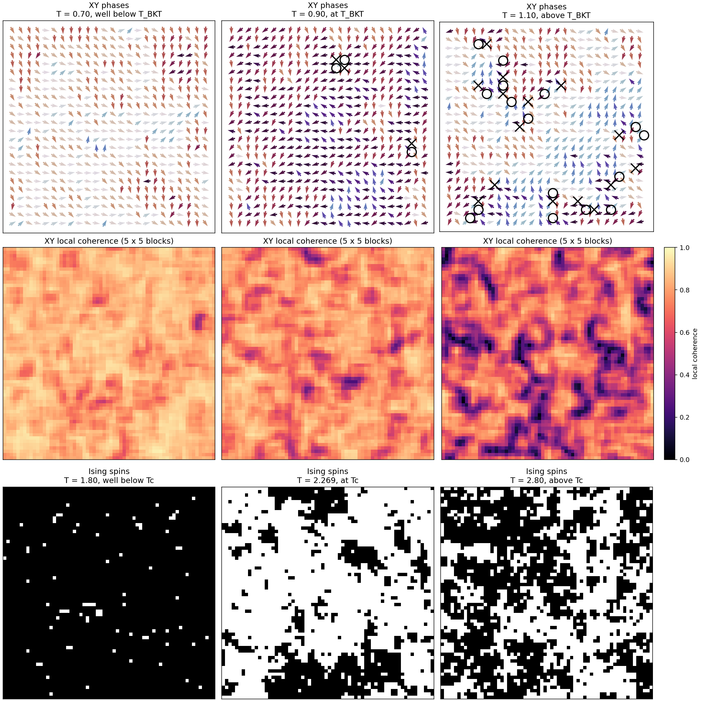
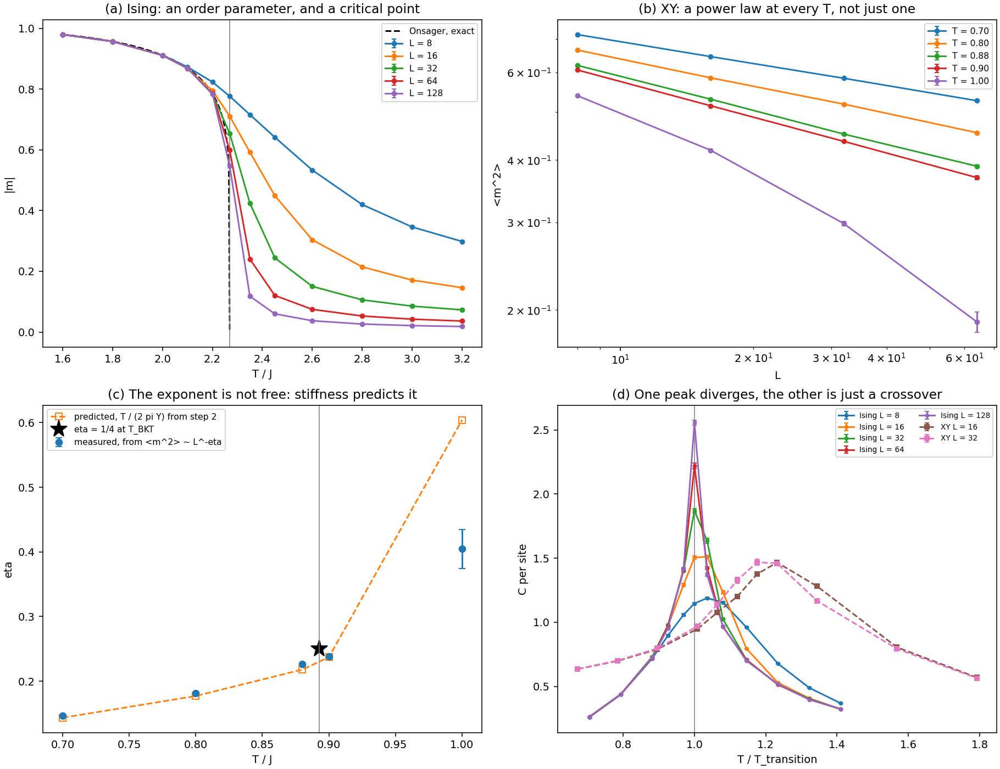

# The BKT Transition in a 2D XY Model — Toward Thin-Film Superconductors

Week-7 agentic project for PHYS 7321 (Statistical Mechanics and the Ising Model).

**Motivation.** Superconductivity in an ultrathin film is a 2D phase transition,
and in 2D a phase transition does not work the way mean field theory says. This
project builds the 2D XY model from scratch, measures the Berezinskii-
Kosterlitz-Thouless transition in it, and then connects that result back to what
a superconducting film actually does.

> **No real data in this repo.** The alpha-Sn/beta-Sn results are unpublished
> and under review, and this fork is public. Everything here is simulated or
> synthetic. Applying any of it to real R(T) happens locally, outside the repo,
> and goes public only with the PI's OK. See *Scope and disclosure* at the end.

---

## Status

| Step | What | State |
|------|------|-------|
| 1 | The sampler | **done**, 4/4 checks pass |
| 2 | The universal jump | **done**, 3/3 checks pass |
| 3 | From Cooper pairs to free vortices | **done**, 4/4 checks pass |
| 4 | Two kinds of transition, side by side | **done**, 7/7 checks pass |
| 5 | What a resistance curve can and cannot tell you | next |
| 6 | Real data | local only, later |

Nothing is committed yet. Work one step at a time and stop at each step's check.

**Headline numbers**

| Quantity | Measured | Expected |
|---|---|---|
| T_BKT (all four L) | 0.9051 +/- 0.0028 | 0.8929 |
| T_BKT (dropping L = 8) | 0.9004 +/- 0.0043 | 0.8929 |
| Y at T = 1.10, L = 64 | 0.0028 +/- 0.0071 | 0 |
| 2 Delta(0) / Tc_MF | 3.522 - 3.532 | 3.528 |
| Delta / (Tc sqrt(1 - T/Tc)) as T -> Tc | 3.057 | 3.06 |
| vortex correction to the transition | 0.568 | - |
| Ising beta/nu at Tc | 0.1255 +/- 0.0011 | 0.125 |
| XY eta at T = 0.90 | 0.2384 +/- 0.0004 | 1/4 |
| Ising E/N at Tc, L = 128 | -1.4184 | -1.41421 |
| XY specific-heat peak, L = 16 vs 32 | 1.467, 1.468 | no growth |

---

## Why XY and not Ising

An Ising spin is up or down. The superconducting order parameter is a complex
number whose phase can take any angle, so the lattice model for it carries an
angle theta on each site:

    H = -J sum_<ij> cos(theta_i - theta_j)

That one change — a discrete variable becoming a continuous one — changes the
kind of transition the model can have.

## The physics in one paragraph

In 2D the XY model never develops true long-range order (Mermin-Wagner), but it
still has a phase transition, at T_BKT = 0.8929 J. Below it, vortices and
antivortices are bound in pairs and the phase stays stiff over long distances.
Above it, the pairs unbind, free vortices wander, and the stiffness drops to
zero. In a superconducting film, free vortices moving under a current are what
produce resistance, so the resistive transition of a 2D film *is* vortex
unbinding. The sharpest prediction: the stiffness jumps from 2 T_BKT / pi to
zero at the transition, a universal number (Nelson and Kosterlitz, 1977).

---

# Results

## Step 1 — the sampler  ✅

`xy.py` (sweep, energy, stiffness, vortex counting) and `checks_step1.py`.

Validated against four things with known answers:

1. **Low T (spin waves).** E/N = -2 + T/2 and Y = 1 - T/4, up to O(T^2).
   At T = 0.1: E/N = -1.94954 +/- 0.00011 vs -1.95, Y = 0.97455 +/- 0.00006 vs
   0.975. At T = 0.2: E/N = -1.89760 +/- 0.00015 vs -1.90, Y = 0.94783 +/-
   0.00008 vs 0.95. The leftover grows like T^2, as the next order should.
2. **High T (series).** E/N = -2 (u + 2 u^3), u = I1(1/T) / I0(1/T). At T = 5:
   -0.20254 +/- 0.00039 vs -0.20295. The bond-only term alone gives -0.19901,
   9 sigma away — so the check has teeth.
3. **Topology.** Net vorticity is exactly zero in every configuration of every
   run (a torus has no boundary for a vortex to escape through). Vortex density
   0 at T = 0.1, 0.137 per site at T = 1.5.
4. **Two starts agree** at T = 1.2.

**What it means.** The sampler is correct at both ends of the temperature range,
and the crossover between the two analytic limits happens right around T_BKT.
Everything after this rests on this figure.

## Step 2 — the universal jump  ✅

`jump.py` (physics) + `checks_step2.py` (parallel driver) + `plot_step2.py`.

Y(T) at L = 8, 16, 32, 64 over T = 0.70-1.10, 15 temperatures, 40000 + 200000
sweeps each, 20 blocks. 61 independent chains, one process each, seeds from
`SeedSequence.spawn`, largest lattices submitted first. About 13 min on 18 cores.

A jump needs an infinite system. On a finite lattice the drop is smooth, so the
standard estimator is where the measured Y(T) crosses the line 2T/pi. Those
crossings sit above T_BKT and come down only like 1/(ln L)^2 — the logarithmic
correction from the marginal flow of the KT equations.

| L | T*(L) |
|---|---|
| 8 | 0.9610 +/- 0.0009 |
| 16 | 0.9390 +/- 0.0013 |
| 32 | 0.9225 +/- 0.0019 |
| 64 | 0.9186 +/- 0.0017 |

**Checks.**

1. **Equilibration** at L = 32, T = 0.92, the slowest point in the sweep:
   Y = 0.5938 +/- 0.0058 from an ordered start vs 0.5951 +/- 0.0037 from a
   random one — 0.2 sigma. Step 1's warning about short runs near T_BKT is
   answered.
2. **T\*(L) falls with L**, as it must.
3. **Extrapolation** gives T_BKT = 0.9051 +/- 0.0028 against the accepted
   0.8929, inside the 0.02 tolerance.

**What it means, and one honest caveat.** The left panel is the jump forming.
At T = 1.10 the stiffness is 0.445 at L = 8 but 0.0028 +/- 0.0071 at L = 64 —
zero within error. The curve is turning into a step as L grows, which is what a
universal jump looks like on a computer.

The headline 0.9051 is 4.4 sigma above 0.8929, which sounds like a
disagreement. It is not; it is a fitting artifact. The weighted fit is dominated
by L = 8, which has by far the smallest error bar and is exactly where a pure
1/(ln L)^2 asymptotic form has no business being used. Dropping it:

| fit | T_BKT | distance from 0.8929 |
|---|---|---|
| all four L | 0.9051 +/- 0.0028 | +0.0122 (4.4 sigma) |
| drop L = 8 | 0.9004 +/- 0.0043 | +0.0075 (1.7 sigma) |

So the simulation agrees with theory once the fit is restricted to the regime
where the fitting form applies. The lesson is about the analysis, not the
physics: a very precise point in the wrong regime can drag an extrapolation
further than an imprecise point in the right one.

**The mechanism, and a trap.** The snapshots are L = 32 at T = 0.70, 0.90 and
1.10: 0, 8 and 52 vortices. At T = 0.90 they sit in visibly tight plus/minus
pairs; at T = 1.10 they are scattered across the lattice.

But look at the fourth panel. **The vortex density is a perfectly smooth curve
through T_BKT — there is no kink at the transition.** This is the single most
counterintuitive thing in the whole project. The transition is *not* "vortices
appear": they are already there below T_BKT, in pairs. It is "pairs come apart."
A measurement that counts vortices will not find the transition. A measurement
that tests whether they are bound — which is what the stiffness does — will.

## Step 3 — from Cooper pairs to free vortices  ✅

`bcs.py` + `checks_step3.py` + `plot_step3.py`.

Minimal lattice models of film superconductivity (a tight-binding lattice with
a self-consistent Cooper-pair gap) supply the **amplitude** of the order
parameter; this project supplies the **phase**. They are two halves of one problem, and this
step joins them.

Mean field theory computes the size of the order parameter and assumes its phase
is rigid. That is exactly the structure of Ising mean field theory — one scalar
fixed by its own average field:

    Delta = U <c_down c_up>        versus        m = tanh(beta J z m)

In 2D that assumption is false. A continuous phase cannot order (Mermin-Wagner),
and what kills the superconductor is the phase unbinding its vortices.

**The three pieces.**

1. Solve the square-lattice attractive-U gap equation for Delta(T) and Tc_MF:

       xi_k = -2 t (cos kx + cos ky) - mu,   E_k = sqrt(xi_k^2 + Delta^2)
       1 = (U / N) sum_k tanh(E_k / 2T) / (2 E_k)

   No Debye cutoff needed — the bandwidth supplies one.
2. Convert the gap to a phase stiffness with the dirty-limit result behind
   Beasley, Mooij and Orlando (1979):

       J(T) = (Delta(T) / 2) (R_Q / R_sq) tanh(Delta(T) / 2T),   R_Q = h / 4e^2

   R_Q = 6.45 kOhm. Only the ratio R_sq / R_Q enters, so the whole bridge has
   **one knob, and it is a measurable one**.
3. Find the transition two ways: the bare Nelson-Kosterlitz criterion
   T = (pi/2) J, which ignores vortices entirely, and T = 0.8929 J, the
   coefficient step 2 measured with vortices in.

**Checks.**

1. Weak coupling is BCS: 2 Delta(0) / Tc_MF = 3.522, 3.526, 3.526, 3.532 for
   U = 1.6, 1.4, 1.2, 1.0, against 3.528.
2. Delta / (Tc sqrt(1 - T/Tc)) extrapolates to 3.057 as T -> Tc, against 3.06.
   The square root is asymptotic — the ratio is only 2.93 at 1 - T/Tc = 0.1 —
   so the constant must be extrapolated, not read off at a finite distance.
   (My first version of this check tested it at finite distance and failed. The
   check was wrong, not the physics.)
3. No superconducting root above Tc_MF.
4. Limits behave: T_BKT / Tc_MF = 0.976 at R_sq / R_Q = 0.05 and 0.039 at
   R_sq / R_Q = 20, monotonic in between, with the vortex-corrected coefficient
   always below the bare one.

**What it means.** Panel (c) is the payoff. At low sheet resistance the phase is
rigid and the mean-field temperature *is* the real transition — mean field
theory is simply right, and you would never know BKT physics existed. At high
sheet resistance the film pairs long before it conducts, and a wide resistive
tail opens between pairing and coherence. The crossover is near
R_sq ~ R_Q = 6.45 kOhm. That single number decides whether vortex physics is
visible in a given film at all.

Panel (b) shows where step 2 earns its keep. The two straight lines are the two
criteria. Using the bare Nelson-Kosterlitz line instead of the measured 0.8929
overestimates the transition temperature by a factor 1/0.568 — a 43% error that
**no mean-field calculation can see**, because it comes entirely from vortices
renormalizing the stiffness.

**Caveat to carry forward.** 0.8929 belongs to the nearest-neighbor XY model,
whose vortex core energy is its own. A real film's core energy differs. Treat
the lattice number as the *size* of the vortex correction, not as a constant to
carry into data.

---

## Step 4 — two kinds of transition, side by side  ✅

`ising.py` + `scaling.py` + `checks_step4.py` + `plot_step4.py`.

Ising and XY on the same lattice, sampled the same way. The only difference is
discrete versus continuous spin, so running them together isolates what that
one change does. 96 runs, about 17 min on 18 cores.

**A note on algorithms.** Metropolis suffers critical slowing down at Tc, which
would have made the Ising L = 128 point worthless. `ising.py` therefore also
implements Swendsen-Wang, which activates bonds between aligned spins and flips
whole connected clusters at once. Metropolis is kept in the file because it is
the same algorithm the XY model uses, and check 0 shows the two agree.

**Checks: all seven pass.**

0. Swendsen-Wang vs Metropolis, Ising L = 32, T = 2.0: |m| = 0.9110 vs
   0.9113 +/- 0.0002. Same physics, one is just faster.
1. **Ising vs Onsager, L = 128.** E/N agrees to four decimals at every
   temperature tested: -1.9282, -1.8593, -1.7456, -1.0283, -0.8173, -0.7453
   against exact -1.9282, -1.8593, -1.7456, -1.0283, -0.8173, -0.7451.
2. |m| vs Onsager below Tc: 0.9796, 0.9569, 0.9113 against 0.9796, 0.9569,
   0.9113.
3. **Ising at Tc is a critical POINT.** |m| ~ L^-x with
   x = 0.1255 +/- 0.0011, against the exact beta/nu = 1/8. And E/N at Tc
   marches to -sqrt 2 as L grows: -1.4912, -1.4502, -1.4341, -1.4235, -1.4184
   for L = 8 ... 128, against -1.41421.
4. XY equilibration at L = 64, T = 0.90: <m^2> = 0.36894 +/- 0.00304 from an
   ordered start vs 0.37368 +/- 0.00267 from a random one, 1.2 sigma.
5. **XY is a critical LINE.** <m^2> ~ L^-eta at *every* temperature below
   T_BKT, and the exponent is not a free parameter -- step 2's stiffness
   predicts it through eta = T / (2 pi Y):

   | T | eta measured | eta predicted | Y(L = 64) |
   |---|---|---|---|
   | 0.70 | 0.1464 +/- 0.0005 | 0.1434 | 0.7767 |
   | 0.80 | 0.1815 +/- 0.0019 | 0.1771 | 0.7191 |
   | 0.88 | 0.2261 +/- 0.0017 | 0.2180 | 0.6425 |
   | 0.90 | 0.2384 +/- 0.0004 | 0.2371 | 0.6041 |
   | 1.00 | 0.4046 +/- 0.0300 | 0.6041 | 0.2635 |

6. eta = 0.2384 +/- 0.0004 at T = 0.90, the grid point nearest T_BKT, against
   the universal 1/4.
7. Peak specific heat. Ising: 1.189, 1.512, 1.871, 2.221, 2.556 for
   L = 8 ... 128 — a 2.15x growth, and ln(128)/ln(8) = 2.33, so it is the
   logarithmic divergence it should be. XY: 1.467 at L = 16 and 1.468 at
   L = 32 — no growth at all.

**What local order looks like.** Row 1 draws the XY phase as an actual vector
field on a 24 x 24 window of an L = 64 lattice, with vortices circled and
antivortices crossed. A vortex stops being an abstraction: it is the pinwheel,
and following the arrows around one turns you through a full 2 pi. At T = 0.90
they come in tight pairs; at T = 1.10 they are everywhere and unpaired.

Row 2 is the answer to "show me order and disorder locally": the length of the
average spin in a 5 x 5 block around each site. Bright is locally aligned, dark
is scrambled, and the dark filaments at T = 1.10 are exactly where the free
vortices are.

**The point of the whole figure** is the comparison between row 2 at T = 0.70
and row 3 at T = 1.80. The XY lattice is bright nearly everywhere — locally it
is as ordered as the Ising lattice deep in its ordered phase — and yet its
global magnetization is decaying to zero as L grows. Local order and no global
order, at the same time. That is what Mermin-Wagner costs you, and it is why
this transition had to be found through stiffness instead of through an order
parameter.

**What the numbers mean.** Panel (a) is an ordinary transition: a curve
sharpening toward a step at Tc, hugging the exact Onsager result below it.
Panel (b) is not: on log-log, <m^2> against L is a straight line at *every*
temperature, so there is a power law everywhere below T_BKT rather than at one
special point. The T = 1.00 curve is visibly bent — that is the critical line
having ended, and the decay turning exponential.

Panel (c) is the strongest result in the project. The measured exponent and the
one predicted by step 2's stiffness agree with no fitted parameters at all,
through four temperatures, and then part company above T_BKT exactly where the
prediction stops being valid. Two independent observables — one from how a
twist costs energy, one from how correlations decay — give the same answer.

Panel (d) is a second version of step 2's trap. The Ising peak grows with L
because it is a real divergence. The XY peak does not grow, and it does not even
sit at T_BKT: it peaks around T / T_BKT ~ 1.2. If you went looking for this
transition with a thermometer, you would find a bump in the wrong place and
conclude the wrong thing.

**Two honest caveats.**

- eta at T_BKT comes out a little low. Interpolating the T = 0.88 and T = 0.90
  points to T_BKT = 0.8929 gives about 0.230, roughly 8% under 1/4. This is a
  known finite-size effect: the approach to 1/4 carries multiplicative
  logarithmic corrections that die very slowly, the same family of corrections
  that made step 2's extrapolation land at 0.9051. Bigger lattices would move
  it up, slowly.
- L = 128 was deliberately left out of the XY runs. Metropolis autocorrelation
  near T_BKT at that size was not verified, and an unverified point is worth
  less than a missing one. The Ising side could go to 128 only because
  Swendsen-Wang removes that problem.

# Plan

## Step 5 — what a resistance curve can and cannot tell you (synthetic)

Above T_BKT the free-vortex density goes as xi^-2 with
xi ~ exp(b / sqrt(T - T_BKT)) (Halperin and Nelson, 1979), and R is proportional
to it. The standard test on data is to plot (d ln R / dT)^(-2/3) against T; for
this form it is a straight line hitting zero at T_BKT.

1. Check the MC free-vortex density above T_BKT against the xi^-2 form.
2. Make synthetic R(T) two ways: (a) a BKT film, (b) an inhomogeneous film —
   a spread of local mean-field Tc values with no vortex physics at all, each
   patch following the BCS form already built in step 3. Run the same
   (d ln R / dT)^(-2/3) analysis on both.
3. **The question that matters:** can the test tell (a) from (b)? How much noise
   or Tc spread does it take to fool it? Step 3 sharpened this — an
   inhomogeneous film and a high-R_sq BKT film can both produce a broad
   resistive tail, and a referee will ask which one you have.

## Step 6 — later, local only

Apply step 5's analysis to the bilayer and beta-Sn R(T) on the user's machine.
Step 3's panel (c) says the first thing to compute is R_sq in units of
R_Q = 6.45 kOhm: that decides whether BKT physics should be visible in those
films at all, before any curve is fitted. R(H) is a separate problem (a field
adds vortices) and is not planned here.

---

# Reference

## Conventions

- J = 1, k_B = 1. L x L square lattice, periodic edges, L even.
- One sweep = checkerboard Metropolis on even sites, then odd. A move adds a
  uniform random angle in [-delta, delta]; delta is tuned during thermalization
  only, toward 50% acceptance, so the measured chain has a fixed proposal.
- Stiffness (helicity modulus) along x, with d = theta_i - theta_(i + x):

      Y_x = (1/N) [ < sum cos d > - (1/T) < (sum sin d)^2 > ]

  averaged over x and y.
- Vortices: the winding of theta around each plaquette (differences wrapped to
  [-pi, pi)), divided by 2 pi, is -1, 0 or +1.
- Error bars from block averages over 20 blocks.
- Short readable numpy. No try/except, no silent defaults.
- Python: `~/anaconda3/bin/python3`.

## Files

| File | What |
|---|---|
| `xy.py` | the model: sweep, energy, bond sums, stiffness, vortices, blocking |
| `checks_step1.py` | step 1 validation, writes `figures/step1.png` |
| `jump.py` | crossings, the 1/(ln L)^2 fit, the parallel worker |
| `checks_step2.py` | step 2 driver, writes `results_step2.npz` |
| `plot_step2.py` | step 2 figures |
| `bcs.py` | gap equation, dirty-limit stiffness, the two criteria |
| `checks_step3.py` | step 3 checks, writes `results_step3.npz` |
| `plot_step3.py` | step 3 figure |
| `ising.py` | Ising model: Metropolis, Swendsen-Wang, exact Onsager results |
| `scaling.py` | finite-size scaling, local coherence, the two workers |
| `checks_step4.py` | step 4 driver, writes `results_step4.npz` |
| `plot_step4.py` | step 4 figures |

## Scope and disclosure

Nothing from unpublished work is in this repo. `bcs.py` is the generic textbook
attractive-U square-lattice model and is presented as such. Research-specific
models and every real number stay out until they are published. Step 6 is
local only.

## Resolved decisions

- Step 2 used L = 8, 16, 32, 64. L = 64 cost about 6 min per temperature with 14
  workers loaded, roughly 2x the single-core benchmark, because all-core clocks
  are lower than single-core boost clocks. Budget accordingly.
- Report the L = 8 fit *and* the drop-L = 8 fit. The difference is the honest
  uncertainty.

## Open decisions (yours)

- Step 5: how to model the inhomogeneous film (Gaussian Tc spread, and what
  shape each local transition takes).
- When to commit. The user commits only when they say so.
