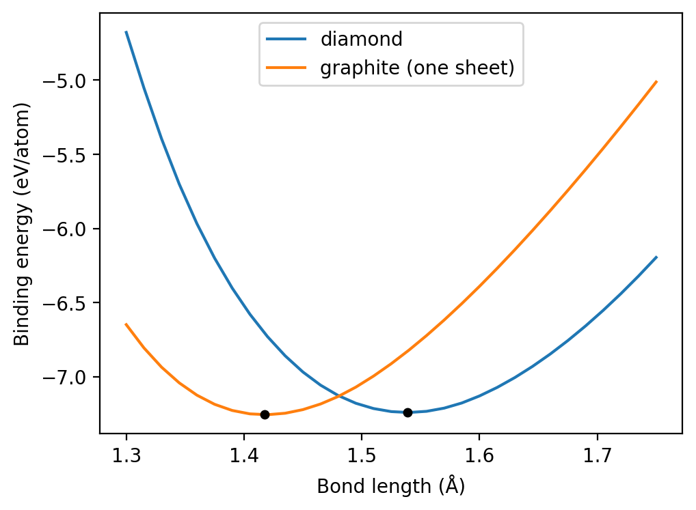
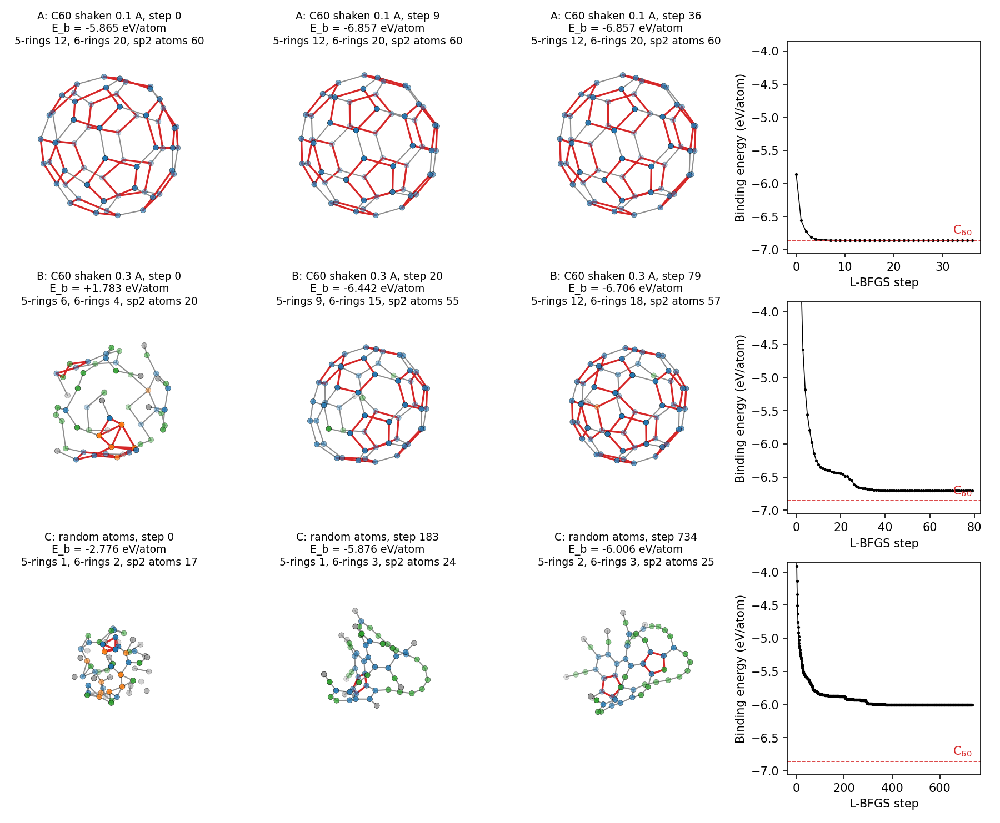
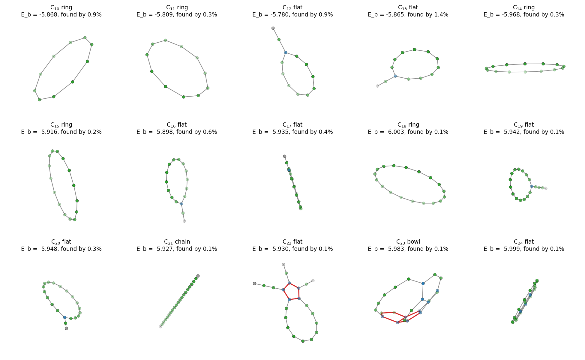
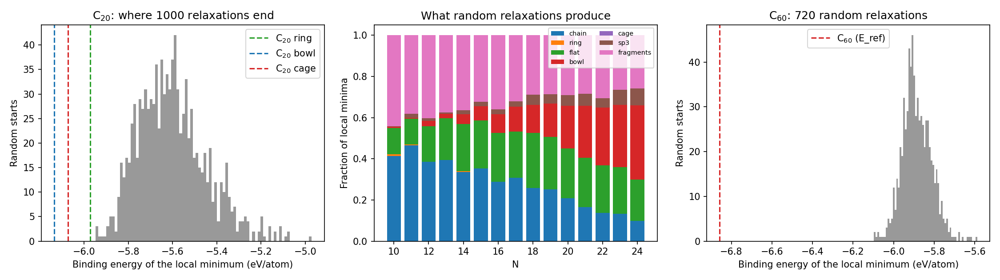
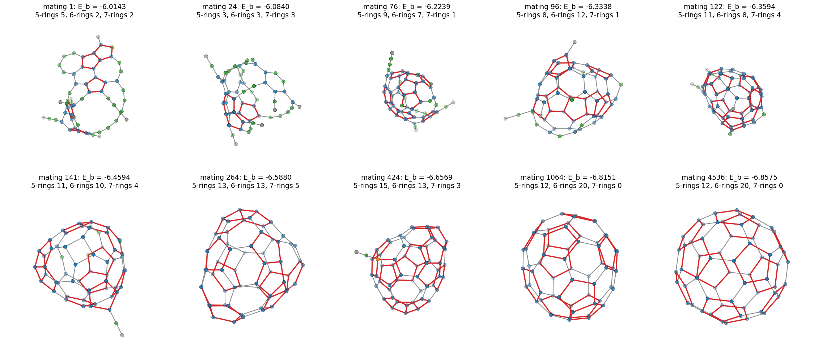
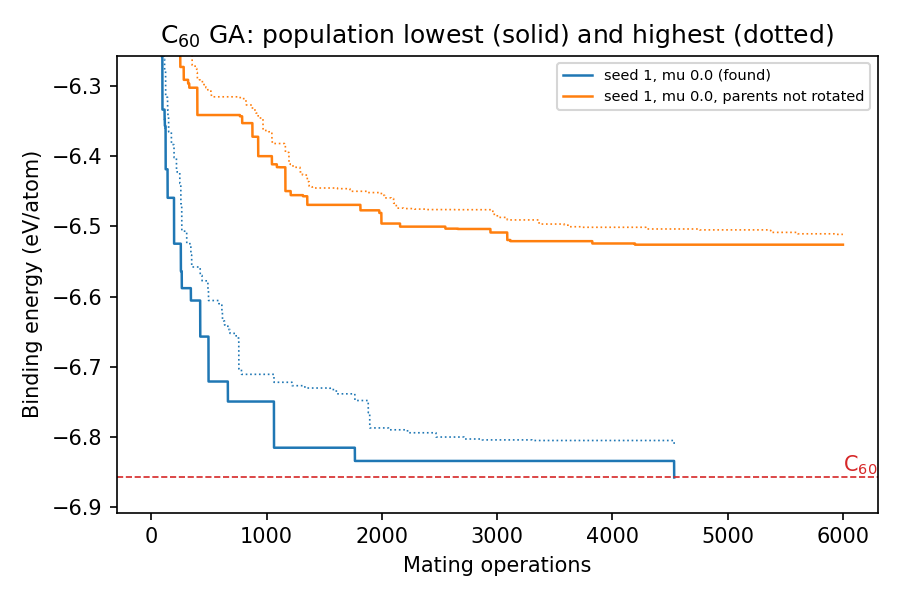

# Results: finding C₆₀ from random atoms

What each step found, with the numbers from the gate scripts. The plan and the
definitions of terms are in [PLAN.md](PLAN.md). Energies are binding energies per atom
(eV/atom, negative = bound) unless stated.

## Summary so far (2026-10-30)

- The carbon tight-binding model works. It puts diamond at 1.539 Å and graphite at
  1.418 Å, with graphite 0.015 eV/atom more stable, as in nature.
- Analytic forces agree with finite differences to 1e−8 eV/Å. One energy+force call
  on 60 atoms takes about 5 ms, so 1000 calls take about 5 s.
- The relaxed C₆₀ has the right shape: two bond lengths (1.458 and 1.396 Å), 12
  pentagons, 20 hexagons, a 1.61 eV HOMO-LUMO gap, 0.40 eV/atom above graphite.
  **E_ref = −6.8575 eV/atom.**
- Relaxation alone cannot find C₆₀. Shake C₆₀ by 0.1 Å and it comes back. Shake it by
  0.3 Å and it lands in a defective cage 0.15 eV/atom higher. Start from random atoms and
  it ends in a tangle of chains 0.85 eV/atom higher. This is the reason for Steps 4–7.

## Step 1: the energy (`gate1.py`)

| Check | Target | Result |
|---|---|---|
| 1. 18 atoms 10 Å apart | binding 0 | 2e−16 eV/atom |
| 2. Diamond minimum | 1.54 ± 0.01 Å | **1.5390 Å**, −7.2413 eV/atom |
| 3. Graphite (one sheet) minimum | 1.42 ± 0.01 Å | **1.4176 Å**, −7.2563 eV/atom |
| 4. Graphite − diamond | within ~0.1 eV/atom | **−0.0150** eV/atom |
| 5. Rotation + translation of a 20-atom cluster | < 1e−10 eV | 8.5e−14 eV |

k-mesh convergence: diamond 12³ (converged to 2e−7 eV/atom); graphene 48² (to 6e−5
eV/atom; the Dirac cones at K converge slowly).

### Findings about the parameters (checked against the paper, 2026-10-30)

Every parameter in `carbon_tb.py` now matches the text and Tables 1–2 of Xu, Wang, Chan
& Ho (1992). We read the paper through the NEU connection; the PDF is kept outside this
public repo.

**The cutoff tails.** The paper replaces the tail of s(r) by a cubic starting at
r₁ = 2.45 Å and the tail of φ(r) by a cubic starting at **d₁ = 2.57 Å**. Both reach
zero at 2.6 Å. In both cases the coefficients are fixed by matching value and slope at the
start and requiring zero value and slope at 2.6 Å. The code computes them by that rule
and reproduces Table 2: the s(r) tail to 7e−8 and the φ(r) tail to 2e−11. (An earlier
version wrongly started the φ tail at 2.45 Å too and concluded that the remembered
coefficients were wrong. They were right. The effect on every energy in this file is
below 1e−4 eV/atom.)

**The energy zero.** The repulsive energy is Σᵢ f(xᵢ) with f(0) = C₀ = −2.59 eV, so a
free atom in the model has energy 2E_s + 2E_p + C₀ = −1.151 eV. Our binding energies are
measured from that. The paper's Fig. 1 instead plots E_tot/N itself: diamond and graphite
both sit at about −8.4 eV/atom there. Ours are −8.392 (diamond) and −8.407 (graphite)
on that scale, which matches.

**The repulsion turns over.** f(x) is a quartic with C₄ < 0. It peaks at x = 146.5 eV and
falls for larger x, so two atoms pushed close enough together would attract without
limit. This happened in the first run of `demo_relax.py`: C₆₀ shaken by 0.3 Å collapsed
to −10²⁴ eV/atom. Real structures sit at x ≈ 50 eV (diamond 47.4, graphene 52.2, C₆₀
49.3). The code now uses the published f for x ≤ 100 eV and its tangent line beyond.
This changes nothing for real structures and keeps overlapping atoms repelling.

## Step 2: the forces (`gate2.py`)

| Cluster | Pairs < 2.6 Å (in tail) | Atoms with x > 100 | HOMO-LUMO gap | max \|F − F_fd\| | \|Σ F\| |
|---|---|---|---|---|---|
| 10 atoms, min distance 1.2 Å | 27 (5) | 0 | 0.67 eV | 1.1e−8 eV/Å | 6e−15 |
| 10 atoms, min distance 1.2 Å | 15 (1) | 0 | 0.43 eV | 7.6e−9 eV/Å | 4e−16 |
| 24 atoms, min distance 1.2 Å | 62 (5) | 0 | 0.17 eV | 2.6e−8 eV/Å | 4e−15 |
| 12 atoms squeezed, min distance 0.8 Å | 59 (3) | 10 | 0.54 eV | 5.1e−8 eV/Å | 4e−14 |

The target was 1e−6 eV/Å for the finite-difference match (h = 1e−5 Å) and 1e−10 for the
net force. The last row tests the tangent-line branch of f. The net torque on the
24-atom cluster is 4e−14 eV.

**Timing**, one energy+force call on 60 atoms: 5–7 ms (perfect C₆₀, 270 pairs), 4–10 ms
(random 60 atoms). Most of the time goes into diagonalizing the 240×240 matrix.

## Step 3: relaxed C₆₀, the target (`gate3.py`)

Starting from the perfect truncated icosahedron with 1.42 Å edges, L-BFGS converges in 7
iterations to max |F| = 3e−9 eV/Å.

| Check | Target | Result |
|---|---|---|
| 1. Neighbors within 1.6 Å | 3 for every atom, 90 bonds | 3 for every atom, 90 bonds |
| 2. Bond lengths | two, single > double | 60 pentagon edges **1.4576 Å**, 30 hexagon-hexagon edges **1.3962 Å** (spread 1e−11) |
| 3. Rings | 12 pentagons, 20 hexagons | 12 and 20; no 3-, 4-, or 7-rings |
| 4. Energy | a few tenths above graphite | **−6.8575 eV/atom**, 0.399 above graphite |
| 5. HOMO-LUMO gap | open, 1–2 eV | **1.615 eV**; HOMO 5-fold (h_u), LUMO 3-fold (t₁u) |

For comparison, experiment gives bond lengths of about 1.45 and 1.40 Å, and DFT puts
C₆₀ about 0.4 eV/atom above graphite. The degeneracies match the icosahedral labels.
All 60 atoms sit at the same radius, 3.557 Å (spread 1e−12), as they must by symmetry.

## Pictures: what relaxation alone does (`demo_relax.py`)

Three starts, each relaxed with L-BFGS to max |F| < 1e−4 eV/Å:

| Start | Steps | End: E_b | End − E_ref | What it ends as |
|---|---|---|---|---|
| A: C₆₀ shaken by 0.1 Å | 36 | −6.8575 | **0.0000** | C₆₀ again |
| B: C₆₀ shaken by 0.3 Å | 79 | −6.7059 | +0.152 | a defective cage: 12 pentagons but only 18 hexagons, 3 atoms not 3-bonded |
| C: 60 random atoms in a sphere of radius 4.6 Å | 734 | −6.0063 | +0.851 | chains and a few rings: 28 two-bonded atoms, 2 pentagons, 3 hexagons |

Columns: start, a quarter of the way, end, and energy against L-BFGS step. The dashed
line is E_ref. Atoms: green = 2 bonds (chain), blue = 3 (sp², as in graphite and C₆₀),
orange = 4 (sp³, as in diamond). Red bonds lie on a pentagon.

C₆₀ sits in a narrow basin. A 0.3 Å shake is a fifth of a bond length, and it already
lands somewhere else. A random start is hopeless for relaxation alone.

- `relax_random.gif`: run C as a rotating movie.
- `viewer.html`: open in any browser. Drag to rotate, use the slider or Play to step
  through each relaxation, and pick the run from the menu (A, B, C, or the reference C₆₀).

## Step 4: random multistart (`step4_multistart.py`, 6.5 min on 18 cores)

### A. The C₂₀ isomers, compared with Deaven & Ho

Built directly and relaxed: the monocyclic ring, the bowl (the corannulene skeleton,
one pentagon ringed by five hexagons, cut out of our C₆₀), and the dodecahedral cage.

| C₂₀ isomer | E_b (ours) | ours − bowl | D&H − bowl | D&H energy − our E_tot/N |
|---|---|---|---|---|
| bowl ("polycyclic cap" in D&H) | −6.1361 | 0 | 0 | −1.384 |
| cage | −6.0735 | +0.0625 | +0.058 | −1.389 |
| ring | −5.9730 | +0.1631 | +0.168 | −1.379 |

- The order (bowl < cage < ring) and the gaps agree with D&H to 0.005 eV/atom.
- Their energies are ours shifted by the same −1.38 eV/atom for all three. So D&H used
  the same model with a different energy zero, and all our comparisons use differences.
- C₂₀ bowl − C₆₀ = +0.721 eV/atom. D&H's numbers give −8.671 − (−9.39) ≈ +0.72, where
  −9.39 is read off their Fig. 1.
- **The ring is a Peierls chain.** Started as a perfect circle it stays there, at a
  saddle point, 0.025 eV/atom higher. A small kick lets it dimerize: bonds alternate
  1.270 / 1.349 Å and the HOMO-LUMO gap opens from 0.11 to 0.61 eV. Only the dimerized
  ring matches D&H.

### B. 1000 random starts for each N = 10…24 (15,000 relaxations, 175 s)

Random atoms in a sphere of radius 1.25 N^{1/3} Å, no two closer than 1.2 Å, each
relaxed to max |F| < 1e−3 eV/Å. All 15,000 converged.

| N | best E_b | best is a | found by | distinct minima | calls per start | first 500 starts miss the best by |
|---|---|---|---|---|---|---|
| 10 | −5.868 | ring | 0.9% | 181 | 134 | 0 |
| 12 | −5.780 | ring + tail | 0.9% | 324 | 182 | 0 |
| 14 | −5.968 | ring | 0.3% | 414 | 248 | 0 |
| 16 | −5.898 | ring + tail | 0.6% | 471 | 307 | 0 |
| 18 | −6.003 | ring | 0.1% | 473 | 378 | +0.101 |
| 20 | −5.948 | ring + tail | 0.3% | 469 | 440 | +0.036 |
| 22 | −5.930 | ring + tails | 0.1% | 471 | 500 | 0 |
| 24 | −5.999 | planar | 0.1% | 435 | 551 | 0 |

The odd N are in `step4_log.txt`. "Distinct minima" counts energies that differ by more
than 1e−3 eV/atom.

**Gate 4 fails, and that is the finding.** The gate asked that the best structure be
stable when the number of starts doubles. For most N the best was found once or a few
times in 1000 starts, and at N = 18, 19, 20, 23 the second 500 starts found something
lower. So multistart has not converged for any N above about 11.

At C₂₀ it fails outright: 0 of 1000 starts reach the bowl, the cage, *or even the ring*.
The best random result (−5.948) is above all three. Almost every start ends in a chain, a
ring with tails, a ragged sheet, or separate pieces: 26–44% of starts break apart.

### C. 720 random starts for C₆₀ (208 s)

| | |
|---|---|
| best of 720 | −6.0973 eV/atom, **0.760 above E_ref**: 3 pentagons, 4 hexagons, 30 two-bonded atoms |
| median | −5.894 eV/atom |
| within 0.01 of E_ref | 0 of 720 |
| calls per start | 885 |
| classes | bowl-like 246, contains sp³ atoms 307, fragments 166, planar 1 |

Random multistart is nowhere near C₆₀. This is the baseline that annealing (Step 5) and
the GA (Step 6) have to beat.

## Step 6: the genetic algorithm (`ga.py`, `step6_ga.py`)

Deaven & Ho's settings: population p = 4, parents chosen with weight exp(−E/T) at
T = 0.2 eV/atom, cut-and-splice, every child relaxed (L-BFGS to 1e−3 eV/Å), no two
members within δE = 0.01 eV/atom, no mutation. 18 children relax at a time.

### The GA finds C₆₀ from random atoms

Seed 1: **C₆₀ after 4536 matings** (D&H: "roughly 5000"), 386,000 energy+force calls,
124 s on 18 cores. The final cluster is E_ref to 1e−5 eV/atom, with 12 pentagons, 20
hexagons, and a 1.615 eV gap. Random multistart used 637,000 calls and got no closer than
0.76 eV/atom.

The path is the same as in D&H's Fig. 1:
- **Matings 0–500:** a fast drop through tangled, half-open cages with 7-rings.
- **By mating 1064:** a closed cage with the right counts, 12 pentagons and 20 hexagons,
  but with 3 pairs of pentagons sharing an edge. It is 0.042 eV/atom above C₆₀; D&H's
  structure (c) is this kind of cage.
- **Mating 1766:** 2 fused pentagon pairs, 0.0235 eV/atom above.
- **Matings 1766–4536:** an "end game" that removes the last two fusions, leaving every
  pentagon surrounded by hexagons. This is the *isolated-pentagon rule* of fullerene
  chemistry, found here by the optimizer. Each fused pair costs about
  0.0235 × 60 / 2 ≈ 0.7 eV.

| mating | above C₆₀ (eV/atom) | 5 / 6 / 7-rings | fused pentagon pairs | 3-bonded atoms |
|---|---|---|---|---|
| 424 | +0.201 | 15 / 13 / 3 | 12 | 57 |
| 664 | +0.108 | 14 / 16 / 2 | 9 | 60 |
| 1064 | +0.042 | 12 / 20 / 0 | 3 | 60 |
| 1766 | +0.024 | 12 / 20 / 0 | 2 | 60 |
| 4536 | 0.000 | 12 / 20 / 0 | 0 | 60 |

`step6_C60_folding.gif` and `viewer_step6_C60.html` show the 22 improvements.

### What we got wrong first: the parents must be turned independently

The first version cut both parents with the same plane *in their own coordinates*. Run
with the same seed and settings, it never closed a cage: after 6000 matings its best was
an open, curved graphitic sheet with 18 dangling edge atoms, 0.33 eV/atom above C₆₀
(orange curve above; files in `ga_runs/aligned_*`).

The reason is that children inherit their parents' coordinates. After a few generations
every member is a bowl facing the same way, and gluing the top of one aligned bowl to the
bottom of another gives a bowl again. D&H cut with "a random plane passing through the
center of mass of *each* parent". Once each parent is turned to its own random
orientation before the cut, two half-bowls can meet rim to rim, and the cage closes within
about 100 matings. This one change is the difference between failing and finding C₆₀.

A second bug from the first try is also worth recording. We had let a child replace the
*highest* member within δE of it. Copies of the best member (the same structure, lower by
rounding noise, 1e−7) then replaced the other members one by one, until all four were the
same cluster and the search stopped. Now only the nearest-energy twin can be replaced.

## Not yet done (stopped 2026-10-30, 11:41)

- **Step 5, annealing.** The code works (a 3000-step C₂₀ anneal takes 1.3 s and the
  temperature follows the ramp), but the full study, 36 C₂₀ and 18 C₆₀ runs per schedule
  up to 300k MD steps, needed about 45 min and was stopped. No annealing results yet.
- **More GA ecologies.** One C₆₀ ecology found C₆₀. A success rate needs several more
  (2–4 min each), and D&H's C₂₀ test (μ = 0 vs 0.05) has not been run.
- **Step 7, the comparison plot.** `step7_compare.py` is ready and needs the two items above.

## Open items

- Forces assume an open HOMO-LUMO gap. Watch for line-search failures in Steps 5–6;
  the fix would be Fermi smearing.
